# Section 3.4 – White-Box Testing

**Function Under Test**: `checkCompliance(assignment, files, submittedAt)`  
**Source Location**: `backend/src/services/submissionFiles.js` (lines 76–88)  
**Author / QA Engineer**: Member 2 (EC4206 Software Testing & Quality Assurance)  
**Branch**: `qa/member-2`

---

## 1. Function Overview & Purpose

In LabTrack, the core backend assessment workflow centers on automatic submission compliance checking before lecturer grading. The `checkCompliance` function acts as the automated gatekeeper that evaluates whether an attempt meets assignment constraints.

### Source Code
```javascript
export function checkCompliance(assignment, files, submittedAt) {
  const onTime = submittedAt <= assignment.deadline
  const labels = new Set(files.map((file) => file.attachment.toLowerCase().trim()))
  const missing = assignment.requiredFiles.filter((name) => !labels.has(name.toLowerCase().trim()))
  const checks = {
    deadline: { passed: onTime, message: onTime ? 'Submitted on or before the deadline.' : 'Submitted after the deadline; marked late.' },
    fileType: { passed: files.every((file) => assignment.allowedFileTypes.includes(file.type)), message: `Accepted formats: ${assignment.allowedFileTypes.join(', ')}. File contents and extensions were checked.` },
    fileSize: { passed: files.every((file) => file.size <= assignment.maxFileSizeMB * 1024 * 1024), message: `Maximum ${assignment.maxFileSizeMB} MB per file.` },
    requiredFiles: { passed: missing.length === 0, message: missing.length ? `Missing attachments: ${missing.join(', ')}.` : 'All required attachment labels are present.' },
  }
  return { passed: Object.values(checks).every((check) => check.passed), checks }
}
```

---

## 2. Inputs and Outputs

### Inputs
1. `assignment` (`Object`):
   - `deadline` (`Date` | `string`): Assignment deadline timestamp.
   - `allowedFileTypes` (`Array<string>`): List of uppercase formats (e.g. `['PDF', 'ZIP']`).
   - `maxFileSizeMB` (`number`): Maximum permitted size per individual file.
   - `requiredFiles` (`Array<string>`): List of mandatory attachment labels (e.g. `['Report', 'Source Code']`).
2. `files` (`Array<Object>`):
   - List of uploaded file objects with `{ originalName, type, size, attachment, storagePath }`.
3. `submittedAt` (`Date`):
   - Date instance representing the exact receipt timestamp.

### Outputs
- `Object` with schema:
  ```typescript
  {
    passed: boolean,
    checks: {
      deadline: { passed: boolean, message: string },
      fileType: { passed: boolean, message: string },
      fileSize: { passed: boolean, message: string },
      requiredFiles: { passed: boolean, message: string }
    }
  }
  ```

---

## 3. Decision Points & Conditionals

The control logic contains 5 fundamental binary decision points ($D = 5$):

| Decision Point | Condition / Predicate | True Branch | False Branch |
| :--- | :--- | :--- | :--- |
| **D1 (Deadline)** | `submittedAt <= assignment.deadline` | On-time message | Late message |
| **D2 (File Type)** | `files.every(file => allowedFileTypes.includes(file.type))` | All types accepted | Type check failed |
| **D3 (File Size)** | `files.every(file => file.size <= maxBytes)` | All within limit | File size check failed |
| **D4 (Required Files)** | `missing.length === 0` | All present | Missing files message |
| **D5 (Overall Pass)** | `Object.values(checks).every(check => check.passed)` | `passed: true` | `passed: false` |

---

## 4. Control Flow Graph (CFG)

### Graph Nodes and Edges
- **Nodes ($N = 21$)**:
  - `N1`: Entry node & variable initializations (`onTime`, `labels`, `missing`).
  - `N2`: Decision D1 — `onTime` evaluation.
  - `N3`: True outcome for D1 (On-time message).
  - `N4`: False outcome for D1 (Late message).
  - `N5`: Merge point for deadline check into `checks.deadline`.
  - `N6`: Decision D2 — `files.every(...)` allowed file types check.
  - `N7`: True outcome for D2 (`passed = true`).
  - `N8`: False outcome for D2 (`passed = false`).
  - `N9`: Merge point for fileType check.
  - `N10`: Decision D3 — `files.every(...)` size limit check.
  - `N11`: True outcome for D3 (`passed = true`).
  - `N12`: False outcome for D3 (`passed = false`).
  - `N13`: Merge point for fileSize check.
  - `N14`: Decision D4 — `missing.length === 0`.
  - `N15`: True outcome for D4 (`passed = true`, all present).
  - `N16`: False outcome for D4 (`passed = false`, missing labels listed).
  - `N17`: Merge point for requiredFiles check.
  - `N18`: Decision D5 — Overall compliance (`Object.values(checks).every(...)`).
  - `N19`: True outcome for D5 (`overallPassed = true`).
  - `N20`: False outcome for D5 (`overallPassed = false`).
  - `N21`: Exit node — Return composite object `{ passed, checks }`.

- **Edges ($E = 25$)**:
  1. `N1 -> N2`
  2. `N2 -> N3` (D1 True)
  3. `N2 -> N4` (D1 False)
  4. `N3 -> N5`
  5. `N4 -> N5`
  6. `N5 -> N6`
  7. `N6 -> N7` (D2 True)
  8. `N6 -> N8` (D2 False)
  9. `N7 -> N9`
  10. `N8 -> N9`
  11. `N9 -> N10`
  12. `N10 -> N11` (D3 True)
  13. `N10 -> N12` (D3 False)
  14. `N11 -> N13`
  15. `N12 -> N13`
  16. `N13 -> N14`
  17. `N14 -> N15` (D4 True)
  18. `N14 -> N16` (D4 False)
  19. `N15 -> N17`
  20. `N16 -> N17`
  21. `N17 -> N18`
  22. `N18 -> N19` (D5 True)
  23. `N18 -> N20` (D5 False)
  24. `N19 -> N21`
  25. `N20 -> N21`

### Control Flow Diagram
Diagram source file: [control-flow-graph.mermaid](file:///C:/Users/Paviththiran/Desktop/AutoGrader-QA/qa/member2/diagrams/control-flow-graph.mermaid)

```mermaid
flowchart TD
    N1(["Node 1: Entry - checkCompliance(assignment, files, submittedAt)"]) --> N2{"Node 2: Is submittedAt <= assignment.deadline? (onTime)"}
    N2 -- Yes (True) --> N3["Node 3: deadline.message = 'Submitted on or before the deadline.'"]
    N2 -- No (False) --> N4["Node 4: deadline.message = 'Submitted after the deadline; marked late.'"]
    N3 --> N5["Node 5: checks.deadline = { passed: onTime, message }"]
    N4 --> N5
    N5 --> N6{"Node 6: Do all files match allowedFileTypes? (files.every)"}
    N6 -- Yes (True) --> N7["Node 7: checks.fileType.passed = true"]
    N6 -- No (False) --> N8["Node 8: checks.fileType.passed = false"]
    N7 --> N9["Node 9: Set fileType message: 'Accepted formats: ...'"]
    N8 --> N9
    N9 --> N10{"Node 10: Are all file sizes <= maxFileSizeMB? (files.every)"}
    N10 -- Yes (True) --> N11["Node 11: checks.fileSize.passed = true"]
    N10 -- No (False) --> N12["Node 12: checks.fileSize.passed = false"]
    N11 --> N13["Node 13: Set fileSize message: 'Maximum X MB per file.'"]
    N12 --> N13
    N13 --> N14{"Node 14: Is missing.length === 0? (all required files attached)"}
    N14 -- Yes (True) --> N15["Node 15: checks.requiredFiles.passed = true; 'All required attachment labels are present.'"]
    N14 -- No (False) --> N16["Node 16: checks.requiredFiles.passed = false; 'Missing attachments: ...'"]
    N15 --> N17["Node 17: Merge requiredFiles check into checks"]
    N16 --> N17
    N17 --> N18{"Node 18: Are all 4 checks passed? (Object.values(checks).every)"}
    N18 -- Yes (True) --> N19["Node 19: overallPassed = true"]
    N18 -- No (False) --> N20["Node 20: overallPassed = false"]
    N19 --> N21(["Node 21: Exit - Return { passed, checks }"])
    N20 --> N21
```



---

## 5. Cyclomatic Complexity Calculation

### Method 1: Edge-Node Formula
$$V(G) = E - N + 2P$$
- Edges ($E$) = $25$
- Nodes ($N$) = $21$
- Connected Components ($P$) = $1$

$$V(G) = 25 - 21 + 2(1) = 4 + 2 = 6$$

### Method 2: Predicate Node (Decision Point) Formula
$$V(G) = \text{Number of Decision Points } (D) + 1$$
- Decision Points ($D$) = $5$ (Nodes `N2`, `N6`, `N10`, `N14`, `N18`)

$$V(G) = 5 + 1 = 6$$

### Method 3: Bounded Regions of Planar Graph
- Closed enclosed planar regions = $5$
- Unbounded outer region = $1$

$$\text{Total Regions } R = 5 + 1 = 6$$

All three independent mathematical methods yield **$V(G) = 6$**.

---

## 6. Independent Basis Paths

Because $V(G) = 6$, there are exactly 6 linearly independent basis paths that span the execution space of `checkCompliance`:

| Path ID | Node Sequence | Decision Profile | Expected Result |
| :--- | :--- | :--- | :--- |
| **Path 1** | `1-2-3-5-6-7-9-10-11-13-14-15-17-18-19-21` | D1:T, D2:T, D3:T, D4:T, D5:T | `passed: true` (All checks pass) |
| **Path 2** | `1-2-4-5-6-7-9-10-11-13-14-15-17-18-20-21` | D1:F, D2:T, D3:T, D4:T, D5:F | `passed: false` (Deadline failed / Late) |
| **Path 3** | `1-2-3-5-6-8-9-10-11-13-14-15-17-18-20-21` | D1:T, D2:F, D3:T, D4:T, D5:F | `passed: false` (Unsupported file type) |
| **Path 4** | `1-2-3-5-6-7-9-10-12-13-14-15-17-18-20-21` | D1:T, D2:T, D3:F, D4:T, D5:F | `passed: false` (File size limit exceeded) |
| **Path 5** | `1-2-3-5-6-7-9-10-11-13-14-16-17-18-20-21` | D1:T, D2:T, D3:T, D4:F, D5:F | `passed: false` (Missing required attachment) |
| **Path 6** | `1-2-4-5-6-8-9-10-12-13-14-16-17-18-20-21` | D1:F, D2:F, D3:F, D4:F, D5:F | `passed: false` (Compound failure across all checks) |

---

## 7. White-Box Test Case Design Matrix

| Test ID | Targeted Basis Path | Input Specification | Expected Output |
| :--- | :--- | :--- | :--- |
| **TC-WB-01** | Path 1 (Nominal / Full Pass) | Deadline: `2030-01-01`<br>Submitted: `2029-12-31`<br>Allowed: `['PDF']`, Max: `10MB`<br>Required: `['Report']`<br>Files: `[{ type: 'PDF', size: 1MB, attachment: 'Report' }]` | `passed: true`<br>All 4 sub-checks `passed: true` |
| **TC-WB-02** | Path 2 (Late Submission) | Deadline: `2025-01-01`<br>Submitted: `2025-01-02` (after deadline)<br>Allowed: `['PDF']`, Max: `10MB`, Required: `['Report']`<br>Files: `[{ type: 'PDF', size: 1MB, attachment: 'Report' }]` | `passed: false`<br>`checks.deadline.passed: false`<br>Message contains: `'marked late'` |
| **TC-WB-03** | Path 3 (Disallowed File Type) | Deadline: `2030-01-01`<br>Submitted: `2029-12-31`<br>Allowed: `['PDF']`<br>Files: `[{ type: 'ZIP', size: 1MB, attachment: 'Report' }]` | `passed: false`<br>`checks.fileType.passed: false`<br>Message contains allowed formats |
| **TC-WB-04** | Path 4 (Oversized File) | Deadline: `2030-01-01`<br>Allowed: `['PDF']`, Max: `2MB`<br>Files: `[{ type: 'PDF', size: 3MB (3145728 B), attachment: 'Report' }]` | `passed: false`<br>`checks.fileSize.passed: false`<br>Message: `'Maximum 2 MB per file.'` |
| **TC-WB-05** | Path 5 (Missing Required Attachment) | Deadline: `2030-01-01`<br>Required: `['Report', 'Code']`<br>Files: `[{ type: 'PDF', size: 1MB, attachment: 'Report' }]` | `passed: false`<br>`checks.requiredFiles.passed: false`<br>Message: `'Missing attachments: Code.'` |
| **TC-WB-06** | Path 6 (Compound Multi-Failure) | Submitted after deadline,<br>type `PNG` when only `PDF` allowed,<br>size 15MB when limit is 10MB,<br>attachment `'Draft'` when `'Final Report'` required | `passed: false`<br>All 4 sub-checks `passed: false` |
